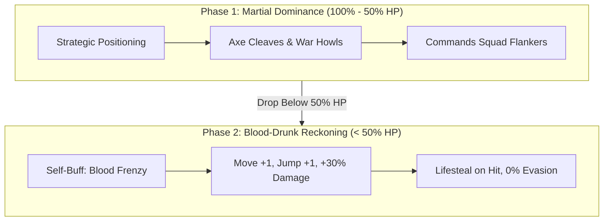

# Tactical Enemy Profiles: The Bloodtusk Orcs
### A *Final Fantasy Tactics* × *Knights of Ages* Character System (3D Tile Maps)


> **Design Objective**: Built for **3D tile tactical combat** (featuring height levels $h$, elevation jumps $J$, cliff fall damage, and directional facing) combined with **Knights of Ages** bloodline purity, morale, and combat injuries.

---

## Clan Identity: The Bloodtusk Warband

* **Cultural Roots**: A battle-tested orcish mercenary clan roaming borderlands and contested ruins. They fight under contractual oaths or territorial blood-feuds.
* **Lineage Purity**: High Orcish Ancestry ($70\%\text{--}95\%$). Produces massive upper-body strength, thick bone density, and low magical aptitude.
* **Combat Philosophy**: Overwhelm defensive lines with heavy two-handed axes, exploit height advantages to plunge into enemy formations, and trigger uncontrollable rage (*Blood Frenzy*) when injured.

---

## Profile 1: Torga Gorefang (Unique Boss)
* **Title**: *Matron of the Cleaved Bone*
* **Class**: **Warmonger Matron** (Unique Boss Class)
* **Encounter Role**: High-threat frontline commander with a 2-phase enrage mechanic.



### Core Attributes (3D Tile Metrics)
* **Move (M)**: $4$ Tiles (increases to $5$ in Phase 2)
* **Jump (J)**: $3$ Height Units (can scale $3h$ high ledges and boulders)
* **Base HP**: $680$ | **MP**: $45$
* **Bravery**: $90$ *(Extremely high reaction trigger rate; immune to cowardice)*
* **Faith / Will**: $32$ *(Heavy resistance to Faith-based holy spells, but low M.DEF against raw black magic)*
* **Physical Attack (PA)**: $24$ | **Physical Defense (PD)**: $18$
* **Magical Attack (MA)**: $8$ | **Magical Defense (MD)**: $10$
* **Speed (Initiative)**: $11$

### Bloodline & Heritage Traits (*Knights of Ages*)
* **92% Ancient Orc Blood**: $+25\%$ physical stat growth cap; base melee stagger resistance $+40\%$.
* **Battle Scar — Iron Rib**: Piercing attacks (arrows, spears) suffer a $-25\%$ damage penalty.
* **Aura of the Warlord**: Friendly orcs within $3$ tiles gain $+10$ Bravery and cannot fall below $40$ Morale.

### Ability Kit (FFT Style: A / R / S / M)
* **Action Ability (A-Ability) — *Gore-Craft***:
  1. **Blood Cleave**: *Range: 1, Height Tol: 1.5h, AoE: 3-tile frontal arc, Cost: 0 MP*.
     * Deals $\text{PA} \times 1.4$ slashing damage. Inflicts **Bleed** for 3 turns.
  2. **Skull-Crusher**: *Range: 1, Height Tol: 2h, Single Target, Cost: 12 MP*.
     * Deals $\text{PA} \times 1.8$ physical blunt damage. $100\%$ chance to break enemy Helmet/Headgear or lower P.DEF by $30\%$.
  3. **Plunging Execution**: *Range: 1–2, Height Requirement: Attacker must be $\ge 1.5h$ higher than target, Cost: 15 MP*.
     * Leaps off a high ledge onto the victim. Deals $\text{PA} \times 2.0$ plus $+15\%$ extra damage per height unit fallen. Torga takes zero fall damage.
  4. **Blood-Roar**: *Range: Self, AoE: 3-tile radius, Height Tol: 3h, Cost: 8 MP*.
     * Dispels all status debuffs on allies; inflicts **Fear** ($-25\%$ ATK, cancels reaction abilities) on enemies who fail a Will check.
* **Reaction Ability (R-Ability)**:
  * **Bonecrusher**: When hit by a physical attack while below $50\%$ HP, counters for $1.5\times$ damage before attacker retreats.
* **Support Ability (S-Ability)**:
  * **Titan’s Cleaver**: Two-handed axes ignore target Shield Block and weapon parry chances.
* **Movement Ability (M-Ability)**:
  * **Scent of Blood**: $+1$ Move and $+1$ Jump when moving toward any enemy unit at $< 50\%$ HP.

### Spoils & Steal Table
* **Steal**: *Blood-Forged Great Axe* (Weapon, ATK 34), *Spiked Juggernaut Pauldron* (Accessory, $+4$ PA, $+2$ Jump).
* **Drop**: *Chieftain's War Horn*, *Orcish Clan Insignia* (Mercenary contract item).

---

## Profile 2: Bloodtusk Warmonger (Elite Champion / Sub-Boss)
* **Class**: **Warmonger** (Advanced Melee Job)
* **Encounter Role**: Durable brawler that anchors the battle line, breaks player choke-points, and covers spellcasters.

### Core Attributes (3D Tile Metrics)
* **Move (M)**: $4$ | **Jump (J)**: $2$
* **Base HP**: $440$ | **MP**: $30$
* **Bravery**: $80$ | **Faith / Will**: $38$
* **PA**: $19$ | **PD**: $15$ | **MA**: $6$ | **MD**: $9$ | **Speed**: $10$

### Lineage Traits (*Knights of Ages*)
* **78% Orc Blood**: $+15\%$ Strength, $-10\%$ Magic Defense.
* **Thick Hide**: Immune to the **Bleed** and **Stun** status effects.

### Ability Kit
* **A-Ability (*Savagery*)**:
  * **Sweeping Chop**: Hits 2 tiles horizontally in front of the unit ($1.2\times$ PA).
  * **Armor Cleave**: Strikes 1 target, permanently sundering body armor ($1.3\times$ PA, reduces target P.DEF by $25\%$).
* **R-Ability — *Counter-Cleave***: $60\%$ chance to counter physical melee strikes.
* **S-Ability — *Two-Hands***: Doubles basic attack damage scaling of axes.
* **M-Ability — *Ignore Height (Partial)***: Increases Jump parameter by $+1$ (Total Jump: $3$).

---

## Profile 3: Clan Reaver (Standard Frontline Grunt)
* **Class**: **Reaver / Marauder** (Tier 1 Line Unit)
* **Encounter Role**: Fast, aggressive rush-down unit deployed in pairs or trios to flank player formations.

### Core Attributes (3D Tile Metrics)
* **Move (M)**: $4$ | **Jump (J)**: $2$
* **Base HP**: $290$ | **MP**: $15$
* **Bravery**: $70$ | **Faith / Will**: $42$
* **PA**: $15$ | **PD**: $12$ | **MA**: $5$ | **MD**: $7$ | **Speed**: $10$

### Lineage Traits (*Knights of Ages*)
* **65% Orc Blood**: Base $+10\%$ physical attack.
* **Mercenary Morale**: If their squad leader/boss dies, their Bravery drops by $-20$; susceptible to panic if reduced below $25\%$ HP.

### Ability Kit
* **A-Ability (*Brutality*)**:
  * **Heavy Strike**: Basic melee attack with high knockback ($1$ tile pushback).
  * **Frenzied Charge**: Rushes $2$ straight tiles into combat, dealing $1.1\times$ damage.
* **R-Ability — *Strike Back***: Parries and retaliates against frontal basic attacks ($40\%$ trigger rate).
* **S-Ability — *Attack Boost***: Flat $+15\%$ physical damage.
* **M-Ability — *Move +1***: Expands effective threat zone.

---

## Profile 4: Bone-Splitter Executioner (Anti-Armor Specialist)
* **Class**: **Executioner** (Specialized Combatant)
* **Encounter Role**: Heavy tank-killer deployed against high-defense player Knights and Paladins; leverages high vertical knockback to push player units off 3D cliffs.

### Core Attributes (3D Tile Metrics)
* **Move (M)**: $3$ | **Jump (J)**: $3$
* **Base HP**: $480$ | **MP**: $20$
* **Bravery**: $82$ | **Faith / Will**: $30$
* **PA**: $22$ | **PD**: $17$ | **MA**: $4$ | **MD**: $8$ | **Speed**: $9$

### Lineage Traits (*Knights of Ages*)
* **85% Pureblood Orc**: Extreme muscle density; cannot be knocked back or displaced by enemy abilities.
* **Executioner's Mien**: Striking an enemy from the rear or flank inflicts guaranteed Critical Hit.

### Ability Kit
* **A-Ability (*Execution*)**:
  * **Shield-Breaker**: Target’s shield is knocked out of hand (disables block for 3 turns); $1.4\times$ PA.
  * **Chasm Shove**: Delivers a ferocious kick/pommel strike with **Knockback 2**. On 3D tile maps, pushing a unit off an elevation ledge inflicts fall damage proportional to the height difference ($\Delta h \times 8\%$ Max HP).
  * **Guillotine Chop**: High vertical tolerance ($2.5h$). Deals $1.9\times$ PA damage, dealing $+50\%$ extra damage against units currently afflicted with Bleed or Stun.
* **R-Ability — *Meat Shield***: Redirects $30\%$ of single-target physical damage back to attacker if attacker is on a lower elevation tile.
* **S-Ability — *Armor Piercing***: All abilities treat target's P.DEF as $35\%$ lower.
* **M-Ability — *Cliff Climber***: $+2$ Jump when ascending slopes or stone staircases.

---

## 3D Tile Combat Interactions & Tactical Matrix

```
Facing Multipliers:
- Front Attack: 1.0x Damage | 100% Enemy Counter Chance
- Side / Flank: 1.2x Damage | 50% Enemy Counter Chance
- Backstab:     1.5x Damage | 0% Enemy Counter Chance (Cannot be countered)

Elevation Advantages (Height difference Δh):
- Attacking from Δh >= +2h: +15% Accuracy, +10% Physical Damage, Plunging strike unlocked.
- Knockback over edge: Unit falls to base tile; takes Fall Damage = (Δh * 8% Max HP).
```

### AI Decision Priorities on 3D Maps:
1. **High Ground Dominance**: Prioritize moving onto tiles at $\ge 1.5h$ above player units to enable plunging execution and prevent player archers from getting height multipliers.
2. **Backstab Routing**: Move through flanks to deliver back attacks (avoids player *Counter* and *Blade Grasp* abilities).
3. **Cliff Hazard Exploitation**: If a player unit stands on the rim of a $\ge 3h$ drop, Executioners prioritize *Chasm Shove* over direct attacks to inflict massive fall damage.
