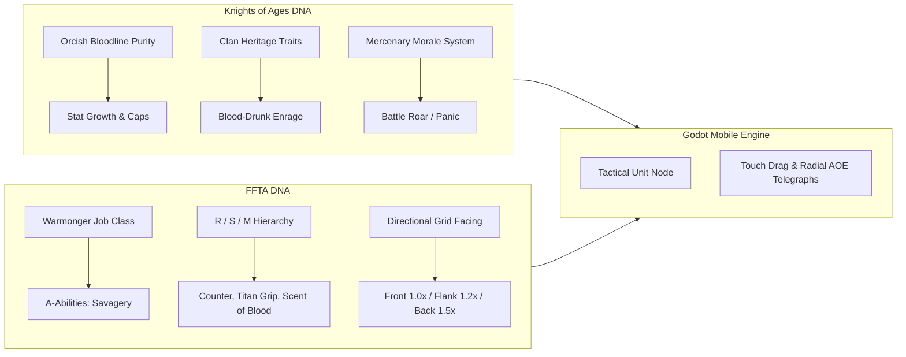
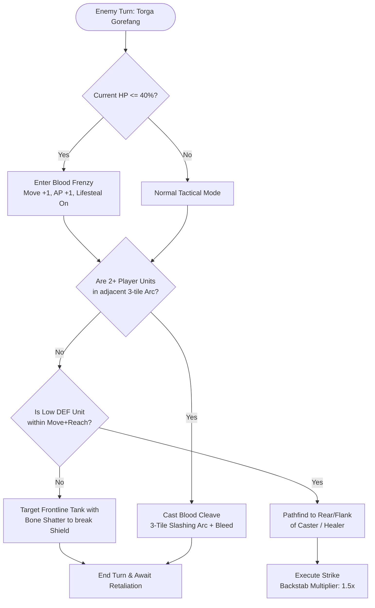

# Enemy Profile: Torga Gorefang (Orc Warmonger)
### Tactical RPG Character Design & Godot Mobile Sprite Sheet Guide

> **System Fusion**: Blending the gritty bloodlines, clan heritage, and mercenary morale of **Knights of Ages** with the iconic grid combat, Job/Ability hierarchy (A/R/S/M), and directional facing mechanics of **Final Fantasy Tactics Advance (FFTA)**. Built natively for **Godot 4 on Mobile (Android)**.

---

## 1. Character Identity & Visual Breakdown


* **Boss Name**: **Torga Gorefang, Matron of the Cleaved Bone**
* **Generic Class Archetype**: **Orc Warmonger** (Elite Tier 2 Melee Striker / Shock Trooper)
* **Clan / Allegiance**: **The Ironblood Warband** (*Goretusk Covenant*)
* **Visual Signature**:
  * **Physique**: Broad, battle-hardened green-skinned musculature with visible abdominal conditioning and battle scars.
  * **Hair & Adornment**: Long dreadlocks and braided cords threaded with metallic war-rings and ivory trophy beads.
  * **Armor**: Spiked iron pauldron (left shoulder), fur-trimmed hardened leather combat bodice, brass-studded vambraces, and reinforced tassets with iron groin plates.
  * **Armament**: Two-handed heavy iron battleaxe dripping with fresh arterial blood, featuring a reinforced counterweight pommel and dual cleaving crescents.

---

## 2. Mechanics Synthesis: *Knights of Ages* × *Final Fantasy Tactics Advance*



### A. Knights of Ages Hereditary & Bloodline Traits
In *Knights of Ages*, characters inherit generational bloodline purity that dictates their stat potentials, lifespan, and passive traits:
1. **High Orcish Blood (85% Blood Purity)**:
   * **Growth Caps**: Strength $+20\%$, Constitution $+15\%$, Willpower $-10\%$.
   * **Base Resistance**: Highly resistant to physical stagger and bleed effects; naturally susceptible to mental debuffs (Charm, Sleep) and celestial/holy magic.
2. **Heritage Trait — *Blood-Drunk Instinct***:
   * When current HP falls below **$40\%$**, Torga enters **Blood Frenzy**:
     * Action Points (AP) $+1$ per turn.
     * Movement Range $+1$ tile.
     * All attacks gain **$25\%$ Life Drain**.
     * Evasion reduced to $0\%$ (she abandons defense entirely).
3. **Clan Trait — *Scarred Flesh***:
   * Critical strike damage taken from melee weapons is reduced by $15\%$.

---

### B. Final Fantasy Tactics Advance (FFTA) Job Hierarchy
* **Race**: Orc
* **Primary Job**: **Warmonger** (Advanced promotion from Warrior $\rightarrow$ Marauder)
* **Proficiencies**: Great Axes, Spiked Pauldrons, Heavy Leather, War Belts.
* **Movement / Jump**: $4$ Tiles / Jump Height $2$ (capable of scaling two-step tactical cliffs).

#### 1. Action Abilities (A-Abilities: "Savagery")
| Ability Name | Target Shape | Cost | Range | Multiplier | Tactical Effect |
| :--- | :--- | :--- | :--- | :--- | :--- |
| **Blood Cleave** | 3-Tile Arc (Front) | 2 AP | 1 Tile | **$1.35\times$ P.ATK** | Sweeps a $180^\circ$ arc. Inflicts **Bleed** ($8\%$ max HP per turn for 2 turns). |
| **Bone Shatter** | Single Tile | 2 AP | 1 Tile | **$1.75\times$ P.ATK** | Vertical executioner slam. Ignores $50\%$ target DEF and destroys physical Shields. |
| **Blood-Roar** | 2-Tile Radius AoE | 1 AP | Self AoE | Buff / Debuff | Allies gain $+15$ Bravery/Morale; enemies within 2 tiles check Willpower or suffer **Fear** ($-20\%$ ATK). |
| **Gore Feast** | Single Tile | 2 AP | 1 Tile | **$1.40\times$ P.ATK** | Brutal rend that restores HP equal to $50\%$ of physical damage dealt. |

#### 2. Reaction Ability (R-Ability)
* **Gore Retaliation**: When struck by any adjacent melee attack, Torga has an $80\%$ chance (scaled by Bravery) to immediately counter-attack with an overhead axe chop for $1.0\times$ damage before the attacker completes their turn.

#### 3. Support Ability (S-Ability)
* **Titan's Grip**: Allows wielding colossal two-handed weapons without initiative delay. All axe strikes bypass Parry and Shield Block chances.

#### 4. Movement Ability (M-Ability)
* **Scent of Blood**: Grants $+1$ Move if her path ends adjacent to an enemy unit with $< 50\%$ HP remaining.

---

## 3. Stat Profile & Tier Progression

Torga can serve either as a **Named Mercenary Boss** or as a template for elite **Warmonger Clan Champions**.

| Attribute | Tier 1 (Grunt Reaver) | Tier 2 (Elite Warmonger) | Boss (Torga Gorefang) | Tactical Meaning |
| :--- | :--- | :--- | :--- | :--- |
| **Max HP** | 280 | 420 | **540** | Immense health pool; demands focused burst or crowd control. |
| **Bravery / Morale** | 65 | 74 | **85** | Highly resistant to fleeing; high counter-trigger rate. |
| **P. Attack (STR)** | 58 | 78 | **98** | Threatens $1\text{-}2$ hit kills on fragile squishy backline units. |
| **P. Defense (CON)**| 38 | 52 | **64** | Resilient against daggers and arrows. |
| **M. Defense (WIL)**| 16 | 22 | **26** | **Primary Weakness**: Extremely vulnerable to Mages and Elementalists. |
| **Speed (Initiative)**| 50 | 58 | **66** | Moderately fast; spikes to 80+ in Blood Frenzy. |
| **Move / Jump** | 4 / 2 | 4 / 2 | **4 (5 in Frenzy) / 2** | High battlefield mobility. |

> [!WARNING]
> **Tactical Exploit**: Torga’s low Magic Defense ($26$) means offensive casters (Black Mages, Pyromancers, Thunder Warlocks) deal near true damage to her. Keep casters protected by tanky units with *Cover* or *Vanguard Stance*!

---

## 4. Animation Sprite Sheets

To support Godot 4 2D tactical combat, key animation sequences have been generated matching the pixel art aesthetic of the character.

### A. Heavy Overhead Cleave Attack (5 Keyframes)
Sequence: **Stance $\rightarrow$ Windup $\rightarrow$ Downward Cleave $\rightarrow$ Crimson Impact / Spark Burst $\rightarrow$ Follow-Through**.


* **Frame Count**: 5 Frames
* **Frame Breakdown**:
  * *Frame 1 (0.0s)*: Combat ready stance, shifting weight back onto rear foot.
  * *Frame 2 (0.15s)*: Overhead windup, raising the bloodied axe above the head with muscles tensed.
  * *Frame 3 (0.28s)*: Maximum forward velocity swing; dynamic crimson slash arc.
  * *Frame 4 (0.38s)*: Ground slam impact, emitting red gore splatter and ground sparks.
  * *Frame 5 (0.55s)*: Heavy recovery crouch before returning to idle stance.

---

### B. Combat Idle Loop (4 Keyframes)
Sequence: **Resting $\rightarrow$ Chest Inhale / Muscle Flare $\rightarrow$ Peak Exhale $\rightarrow$ Return**.


* **Frame Count**: 4 Frames
* **Loop Rate**: 6 FPS (approx. $0.66$s per cycle)
* **Animation Detail**: Subtle shoulder rise, breathing chest expansion, and axe handle sway.

---

## 5. Godot 4 Mobile Implementation Architecture

The scripts and resources are pre-structured in your project directory:
* Data Model: [unit_data.gd](file:///e:/Ryan/games/Knights%20of%20fantsy/scripts/data/unit_data.gd)
* Ability Engine: [skill_data.gd](file:///e:/Ryan/games/Knights%20of%20fantsy/scripts/data/skill_data.gd)
* Boss Unit Resource: [torga_gorefang.tres](file:///e:/Ryan/games/Knights%20of%20fantsy/data/units/torga_gorefang.tres)
* Tactical AI Controller: [berserker_tactical_ai.gd](file:///e:/Ryan/games/Knights%20of%20fantsy/scripts/ai/berserker_tactical_ai.gd)
* Unit Scene Controller: [tactical_unit.gd](file:///e:/Ryan/games/Knights%20of%20fantsy/scripts/units/tactical_unit.gd)

### A. Setting Up Sprite Sheets in Godot 4
1. **Texture Filter**:
   In Godot Project Settings, ensure **Rendering $\rightarrow$ Textures $\rightarrow$ Canvas Textures $\rightarrow$ Default Texture Filter** is set to **`Nearest`** (or set `texture_filter = TEXTURE_FILTER_NEAREST` on the unit sprite) to maintain crisp pixel art edges on high-DPI Android screens.
2. **Animation Setup via AnimationPlayer**:
   Using `Sprite2D` + `AnimationPlayer` provides precise hitframe event triggers (e.g. inflicting damage and spawning blood particle emitters on frame 3).

```gdscript
# Example AnimationPlayer event track integration in Godot 4
func on_cleave_hitframe():
    # Spawns screen shake and camera rumble on mobile
    CameraManager.shake(0.2, 4.0)
    # Deals damage to all units in the 3-tile forward arc
    CombatManager.execute_area_damage(self, current_target_tiles, "blood_cleave")
```

### B. Mobile Touch Interaction & Telegraphs
* **Tap-to-Target**: Touch anywhere on Torga to display her Move range (Blue tiles) and Threat Danger Zone (Red tiles).
* **Telegraph Arc**: For **Blood Cleave**, highlight the 3 targeted tiles in front of Torga in semi-transparent red grid overlays ($#E6262673$).
* **Blood Frenzy Indicator**: When entering $< 40\%$ HP, trigger an animated red particle aura and screen border vignette on Android so the player immediately realizes she is enraged.

---

## 6. Combat AI Decision Flow


